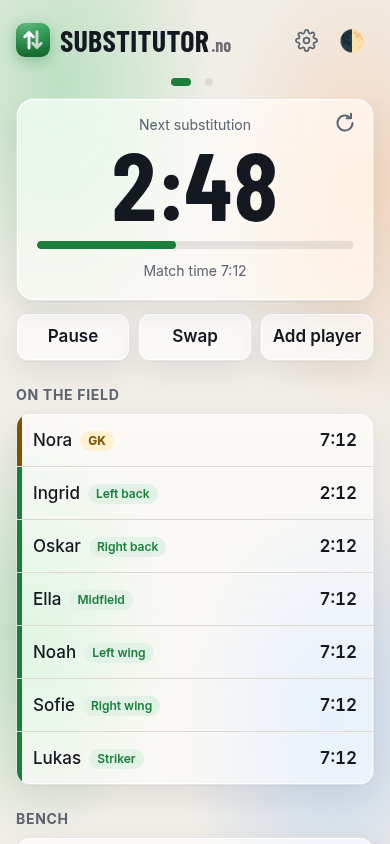
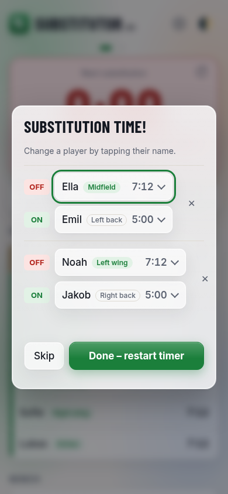
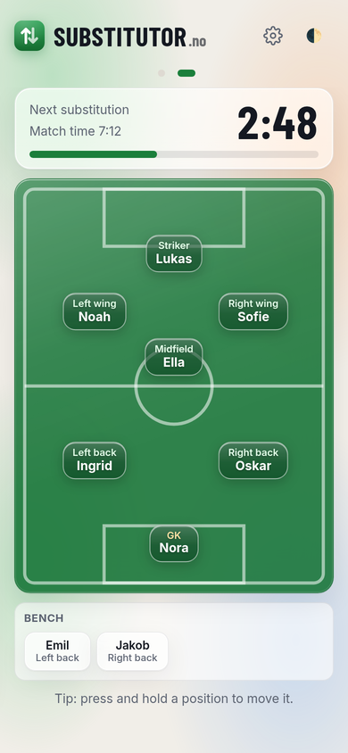
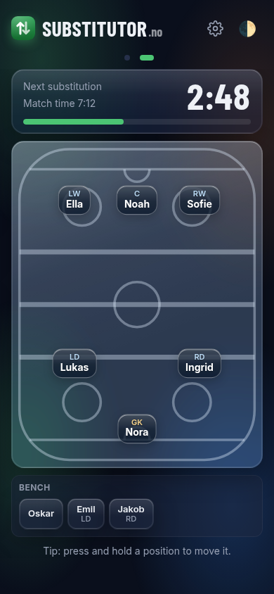
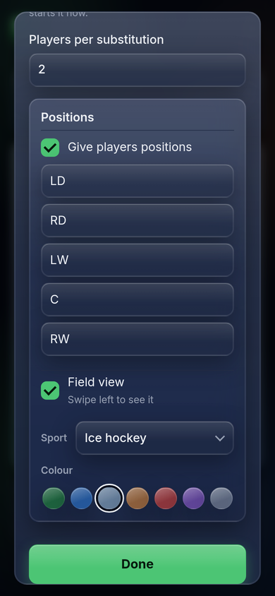
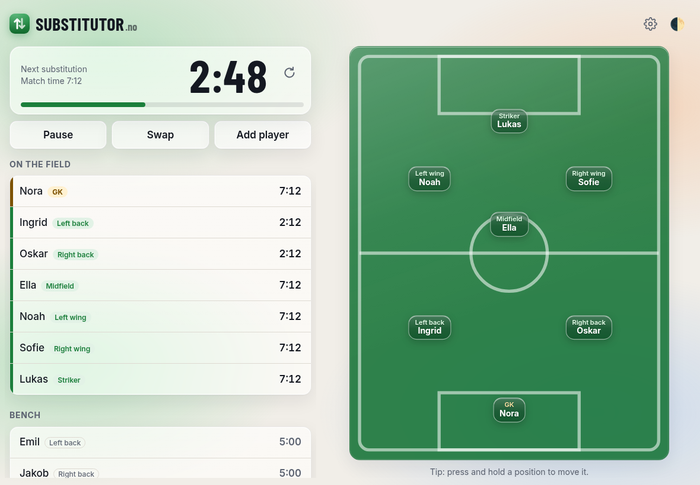
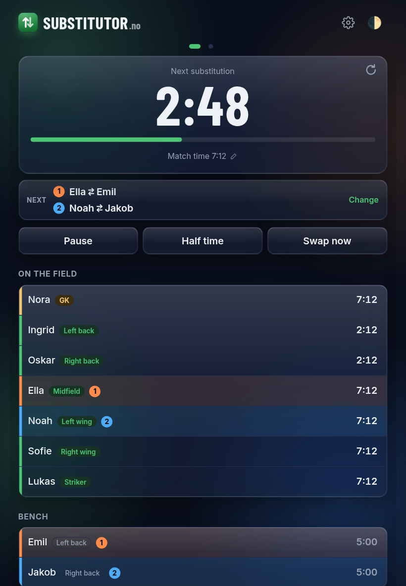

# Substitutor

A phone-friendly web app for fair substitutions in kids' sports matches. It works for any sport with a goalkeeper and rolling substitutions: football, bandy, handball, ice hockey, floorball, futsal…

**No cookies, no tracking, no ads. 100% free and open source.** Your team is saved only on your own phone.

**Open it:** https://substitutor.no

**Install it as an app** (opens full screen from your home screen, and works with no signal). The easiest way is the **Install** button at the bottom of the Players screen. Or do it by hand:
- **iPhone:** open the link in Safari, tap the Share button, then **Add to Home Screen**.
- **Android:** open the link in Chrome, tap the ⋮ menu, then **Install app** (or **Add to Home screen**).

On iPhone, the installed app keeps its own saved team, separate from Safari, so add your players in the installed app.

<p>
  
  
  
  
  
</p>

**Language:** English or Norwegian. It follows your phone's language. The round flag in the top-right corner shows the current language; tap it to switch (it's hidden during a match). Each has its own address: substitutor.no/?lang=no for Norwegian, substitutor.no/?lang=en for English.

## 1. Players

Add your players. The list is saved on the phone.
- **Tap a name** to fix its spelling.
- **✕** removes a player.

## 2. Match setup

- **Players on the field**, including the goalkeeper. If your team has fewer players than that, it's lowered to the number of players, so everyone plays.
- **Goalkeeper**
- **Starting players.** After your first match, the players who played least last time are ticked for you. "Suggest starters from last match" ticks them again if you've changed them.
- **Minutes between substitutions**
- **Players per substitution**
- **Show who swaps next** (on by default): coloured pairs on the match screen showing who swaps at the next substitution.
- **Positions** (optional): tick the box next to "Positions", type a name for each spot (like Left back or Forward), and choose who starts where. Picking a player who already has a spot swaps the two.
- **Field view** (optional, needs positions): adds a picture of the field to the match screen. Choose the **sport** (Football, Bandy, Handball, Ice hockey, Floorball or Futsal) for its lines (red lines for bandy, red and blue for ice hockey), and a **colour**. Each sport comes with its own colour (green grass, ice, a blue or wooden floor), and you can pick another.

Your setup is remembered for the next match.

## 3. During the match

**The clock.** The big countdown shows the time to the next substitution, with the match time underneath.
- **↻** (top-right of the clock) restarts the countdown from the full time, without swapping anyone.
- **Pause** stops the clock for a moment.
- **Half time** stops the clock and shows how long the break has lasted. **Start 2nd half** first shows the next swaps (change them, tap Start 2nd half, or Skip), then starts the clock with a full countdown. The clock then says "2nd half".
- **Tap the match time** (or the countdown) to adjust the clock: −1 min, −10 s, +10 s, +1 min, or type the time, for both the match time and the countdown to the next substitution. Handy if you started the clock late. Changing the match time moves players' minutes with it (but not the countdown), and it can't go back before the last time someone came on or off. The countdown is changed on its own.

**Who's next.** Under the clock, **Next** shows who swaps at the next substitution, so you can answer the players straight away. Each pair has its own colour and number, also on the player list and the field view. Tap the strip to choose other players; your choice is used when it's time (and **Use the app's suggestion** goes back). Switch it off with **Show who swaps next** in setup or ⚙.

**Substitutions.** When it's time, the phone beeps and vibrates and shows who goes **off** and who comes **on**.
- Tap a name to pick someone else. **✕** removes a pair, and **+ Add another swap** adds one.
- **Done** makes the swaps and restarts the countdown. **Skip** restarts it without changes.

**Other buttons and options:**
- **⚙** (top right) opens the match settings: minutes between substitutions (from the next substitution; ↻ starts it now), players per substitution, showing who swaps next, positions on or off and their names, and the field view with its sport and colour. Changes apply at once and are remembered for the next match; **Cancel** undoes everything changed since you opened it. The number of players on the field and the goalkeeper aren't here: use Add player, Remove from match or Make goalkeeper.
- **Swap** swaps players at any time, without changing the countdown.
- **Tap a player** to substitute them now, take them off injured, make them goalkeeper, change position, rename them, or remove them from the match.
- **Add player** (under the bench) is for a late arrival, who comes on at the next substitution.
- **End match** shows the minutes each player played.
- **Move to another phone** (see below).

**What the times mean:**
- The time on the right of each player is their total time on the field.
- For players on the field who have been off before, a small grey time shows how long they've been on since they last came on.

**Positions** (if switched on):
- Each player on the field has a green position tag.
- The player who comes on takes the position of the player who went off.
- To swap two players' positions, tap a player and choose **Change position with…**. The goalkeeper is in the list too: swap with them and the other player goes in goal.
- Bench players show where they last played in a grey tag. The swap lists show positions too, so you can bring on someone for a particular position.

**Field view** (if switched on): **swipe left** on the match screen to see a field with every position and who plays there, the bench below it, and a smaller clock. It's handy for showing the kids. Swipe right, or tap the dots at the top, to go back.
- **Tap a player and choose Swap with…** (the first option) to swap by tapping, like in Fantasy Premier League: the player is highlighted and everyone they can swap with gets a ring. Tap another position to swap places (the goalkeeper too), or a bench player to substitute them straight away. You can also start from a bench player. Tap **Cancel** (bottom right on the field) or the empty field to stop. The countdown isn't restarted.
- **Press and hold** a position to arrange them. They wiggle like app icons on an iPhone, and you can drag any of them where you want.
- The positions start where their names suggest: "Spiss", "Striker" or "ST" at the front, "Høyre back" or "RB" at the back on the right, "Venstre kant" or "LW" out on the left, and so on. English and Norwegian names and the usual short forms work, for every sport: in handball "fløy" and "strek" go up front and a "back" in the middle; in ice hockey C, LW and RW are forwards and LD and RD defenders. Names it doesn't recognise start in the middle.
- Tap **Done**, or an empty part of the field, when you've finished. The layout is remembered for the next match. If you rename a position, it moves back to where its new name suggests.

## On an iPad or tablet

<p>
  
  
</p>

- **Sideways:** the match list and the field are side by side, so there's no swiping. The field gets a little more room. The clock is one compact row (↻ next to the countdown), and the clock, its buttons and the field stay put: only the list of players scrolls, if it doesn't fit. Its bench is left out, since the list next to it shows the bench. Press and hold a position to arrange them, as on a phone.
- **Upright:** one column using the full width. Everything is a little bigger than on a phone, but never so big that you see fewer players than on a phone. The field view is one swipe away, as on a phone.
- The same applies to Android tablets, and to a wide computer window (side by side, normal size).

## How substitutions are chosen

Substitutions rotate:
- The player who has been **on the field longest since they last came on** goes off.
- The player who has **waited longest on the bench** comes on.

This means a player who was in goal for a long time isn't taken off again and again once they're back on the field. The goalkeeper is never substituted unless you choose to. Positions don't change who comes off or on; they only decide where the new player plays.

## Switching phones

To hand over to another coach or another phone in the middle of a match:
1. Tap **Move to another phone** at the bottom of the match screen. Before a match, use **Share team** on the Players screen instead.
2. Send the link (Messages, WhatsApp, AirDrop…).
3. Open the link on the other phone. The team, the setup and the match carry on there, clock and all.

If the other phone uses the installed app on iPhone, copy the link, open the app, and tap **Paste a shared link** on the Players screen instead. The installed app can't read links opened in Safari.

The first phone keeps its match until someone ends it there, so end it once the other phone has taken over.

## Tips

- The screen stays on during the match, and the timer stays correct if the phone locks or the page reloads.
- On iPhone, turn off silent mode to hear the beep. iPhones can't vibrate from a web page.
- Try a practice match with a 1-minute interval before match day.
- The button in the top-right corner (just its icon during a match) switches between **Auto** (follows your phone's dark mode setting), **Light** and **Dark**. Light is easiest to read in bright sunlight.
- If the app looks out of date after an update, close it fully and open it again.

## Development

```sh
npm start        # run locally at http://localhost:8000
npm test         # tests for the substitution rules, share links, sports and translations
npm install      # once, for the browser test
npm run e2e      # browser test of a whole match
npm run screenshots   # remake the screenshots above and the link preview picture
```

`git push` to `main` updates the live site in about a minute (GitHub Pages).

See [CLAUDE.md](CLAUDE.md) for how the code works and [PLAN.md](PLAN.md) for the original plan and every decision since.
